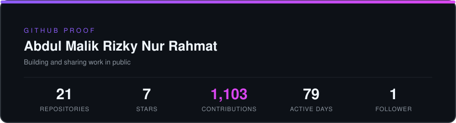
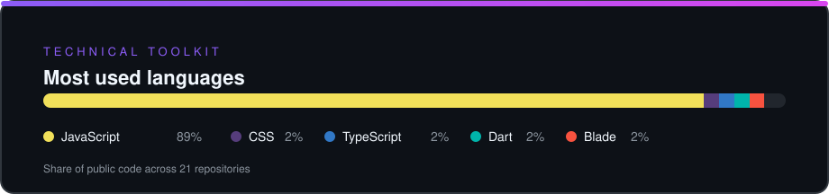
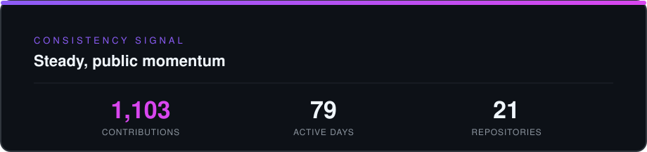
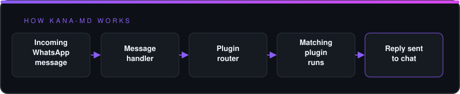

<table width="100%" cellpadding="16">
<tr>
<td width="64%" valign="middle">

RECRUITER SIGNAL BRIEF · ommnidevv

<h1>Abdul Malik Rizky Nur Rahmat</h1>
<h2>Frontend or full-stack engineer</h2>

Im UsE NyArch Linux, btw &gt;_&lt;

<strong>● Building and sharing work in public</strong>

<a href="https://github.com/ommnidevv">GitHub</a> &nbsp;·&nbsp; <a href="https://omnidevv.biz.id">Website</a>

</td>
<td width="36%" valign="middle" align="center">

</td>
</tr>
</table>

<h2>What teams can evaluate quickly</h2>

<table width="100%">
<tr>
<td width="33%" valign="top"><h3>Role fit</h3>
Frontend or full-stack engineer · JavaScript · CSS · TypeScript
</td>
<td width="33%" valign="top"><h3>Public proof</h3>
21 repositories · 7 stars
</td>
<td width="33%" valign="top"><h3>Momentum</h3>
1,103 contributions · 79 active days
</td>
</tr>
</table>

Im UsE NyArch Linux, btw &gt;_&lt;

<h2>Proof at a glance</h2>

<table width="100%">
<tr>
<td width="25%" align="center"><strong>21</strong> Repositories</td>
<td width="25%" align="center"><strong>7</strong> Stars</td>
<td width="25%" align="center"><strong>1,103</strong> Contributions</td>
<td width="25%" align="center"><strong>1</strong> Followers</td>
</tr>
</table>

  

<h2>Selected work</h2>

<table width="100%">
<tr>
<td width="100%" valign="top">
<h3><a href="https://github.com/OmmniDevv/kana-md">kana-md</a></h3>

KANA MD, source code bot WhatsApp moe serba bisa: downloader, game, RPG, AI, fitur grup lengkap, dashboard web, dan semua fitur memakai button

JavaScript · ⭐ 0

<a href="https://github.com/OmmniDevv/kana-md">Read the repository →</a>

</td>
</tr>
</table>

<table width="100%">
<tr>
<td width="33%" valign="top"><h3><a href="https://github.com/OmmniDevv/kana-web">kana-web</a></h3>
Web KANA: dashboard owner dan member bot WhatsApp KANA plus katalog plugin yang selalu mutakhir dari repo kana-md

TypeScript · ⭐ 0
</td>
<td width="33%" valign="top"><h3><a href="https://github.com/OmmniDevv/Elaina-MD">Elaina-MD</a></h3>
WhatsApp Bot multi device berbasis ourin-baileys dengan downloader, game RPG, sticker maker, dan jadibot, yang kini sudah diarsipkan dan digantikan oleh KANA

JavaScript · ⭐ 7 · 🍴 1
</td>
<td width="33%" valign="top"><h3><a href="https://github.com/OmmniDevv/ReSuSFS">ReSuSFS</a></h3>
ReSuSFS v26.10.23 with KMI detection patch for custom kernels (original by ahmed-alnassif, patch by OmmniDevv)

Shell · ⭐ 0
</td>
</tr>
</table>

<h2>Technical toolkit</h2>

  

<h2>Consistency signal</h2>

  

<table width="100%">
<tr>
<td width="62%" valign="middle"><h2>Let’s talk about the next build</h2>
Open to thoughtful teams, ambitious products, and useful engineering work.
</td>
<td width="38%" valign="middle" align="right"><a href="https://github.com/ommnidevv">GitHub</a> <a href="https://omnidevv.biz.id">Website</a> <a href="https://wa.me/6285869074622">WhatsApp</a> <a href="https://t.me/omnidevv">Telegram</a> <a href="https://instagram.com/omnidevv">Instagram</a></td>
</tr>
</table>

Abdul Malik Rizky Nur Rahmat

### How [kana-md](https://github.com/OmmniDevv/kana-md) works

KANA is a plugin-driven WhatsApp bot.

  

